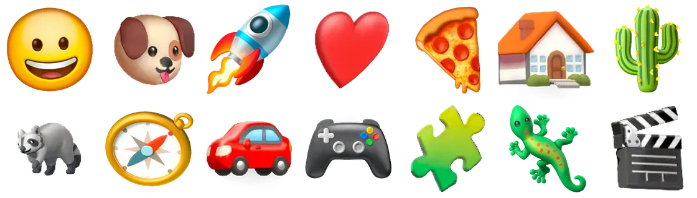

# Splatoto

3D emoji you can turn. Each one began as a front render from [Noto Emoji 3D](https://github.com/googlefonts/noto-emoji/tree/main/3D) and became a 3D Gaussian splat. Splatoto publishes them as sprite atlases: pictures of each emoji seen from many angles, ready to make an emoji turn toward the cursor or spin, with no 3D engine.

> **Unofficial.** Splatoto is not made, endorsed or supported by Google. Noto is a trademark of Google LLC. The pictures are a derivative of Noto Emoji's 3D renders, licensed under the SIL Open Font License 1.1 (see [Licence](#licence)).



**Status (2026-11-15):** the library of 4,007 is being rendered. The first release follows when it's done.

## What's in a release

Each emoji has up to five pictures, named by Noto's file code: the lowercase hex code points joined by `_`, without `fe0f`. For example 😀 is `1f600`, ❤️ is `2764` and 👍🏽 is `1f44d_1f3fd`.

| File | What it holds | Size (typical) |
|---|---|---|
| `<code>.webp` | **The cursor cone.** 9 × 5 views: yaw −45° to 45° in 11.25° steps, tilt +25° to −25° in 12.5° steps | ~105 KB |
| `<code>_360.webp` | **A full turn.** 32 × 5 views: yaw 0° to 348.75° in 11.25° steps, the same five tilts | ~350 KB |
| `<code>_front.webp` | The front view alone, 256 px | ~15 KB |
| `<code>_parts.webp`, `<code>_360_parts.webp` | **Parts maps** for recolouring, in the same cells as the two atlases: per pixel, red = the body colour, green = dark features (eyes, mouth), blue = whites; what's left is accent | ~30 / 100 KB |

- Cells are 128 × 128 px, RGBA (straight alpha). The emoji's larger side fills 84% of the cell, and every view uses the same frame, so cells line up when you step between them.
- Rows run from the camera above (+25°) to the camera below (−25°). In the cone, the middle cell (column 4, row 2) is the original front view; in the 360 sheet it is column 0, row 2.
- A positive yaw moves the camera to the picture's right, so the emoji appears turned toward the picture's left. To face a cursor on the right, use a column left of centre; to face a cursor above, use a lower row.
- `_360.webp` is only included for emoji whose back passed an automatic check. Yellow faces, hands and skin-toned people can come out with dark, ghosted backs, which never show in the cone. `index.json` says which emoji have one.

Releases ship one zip per Unicode group (Smileys & Emotion, People & Body, Animals & Nature, …) plus `index.json`, which lists every code with its name, group and the files it has.

## Use it on a page

```html
<script type="module" src="web/splatoto-emoji.js"></script>

<splatoto-emoji code="1f600" base="./sprites/" size="64"></splatoto-emoji>     <!-- turns toward the cursor -->
<splatoto-emoji code="1f680" base="./sprites/" mode="spin"></splatoto-emoji>   <!-- spins (needs _360) -->
```

### Recolour

```html
<splatoto-emoji code="1f600" recolor="tint #3a7bff"></splatoto-emoji>   <!-- a blue smiley; eyes and teeth stay -->
<splatoto-emoji code="2764" recolor="gold"></splatoto-emoji>
```

Looks: `tint #hex` (the body only), `mono #hex` (every coloured part takes the hue), `hue DEG`, `pastel`, `neon`, `gold`, `chrome`, `clay`, `ink`, `negative`. `web/recolor.js` recolours the finished atlas using its parts map: it moves colours in CIELAB and keeps each pixel's offset from its part's colour, so shading and highlights carry over. It needs pixel access to the images, so serve them from the same origin as the page (or with CORS). `web/demo.html?base=./sprites/` is a playground for every look.

`tools/recolor.py` does the same to a splat itself (`.ply` or `.spz`), for 3D use.

### Plain CSS

Set the atlas as `background-image`, set `background-size` to `900% 500%` (cone) or `3200% 500%` (360), and pick a cell with `background-position: calc(col / (cols − 1) * 100%) calc(row / 4 * 100%)`.

## How they were made

1. **Input:** Noto Emoji 3D's 512 px front renders (`3D/png/512` at commit `99701e0`), cropped to the emoji and centred on grey.
2. **3D:** [IDOL](https://huggingface.co/speridlabs/idol) (Apache-2.0) turns each picture into a 3D Gaussian splat of 262,144 Gaussians and predicts the camera it was seen from. Its two image encoders come from public, ungated weights: timm's DINOv3 ViT-H+/16 and FLUX.2 klein 4B's VAE.
3. **Pose:** `tools/canon.py` uses that camera to turn each splat so the original view faces +Z with +Y up, centred, with its larger side 1 unit long.
4. **Pictures:** `tools/emoji_ship.py` renders every view with [gsplat](https://github.com/nerfstudio-project/gsplat) (orthographic) and scores the front against the source picture (silhouette overlap and colour error). It also checks the back. IDOL sometimes carries a front's baked rim shading round to the back, which shows as a dark copy of the front on yellow and skin-toned subjects (smileys, hands, people). A back fails when its median lightness is under 0.72 of the front's and the body colour is yellow or skin (hue 35–100°, chroma over 20). Dark backs on other things, like a game controller or a clapperboard, are real and pass.
5. **Parts:** `tools/recolor.py` splits each splat's colours into groups (k-means in CIELAB, joined into hue families) and names them body, feature, white or accent. The parts maps are those groups' weights rendered through the same views.
6. **Encoding:** WebP, quality 80, alpha quality 90.

`tools/` holds the pipeline as it was run: `emoji_modal.py` (IDOL on Modal GPUs), `emoji_ship.py` (pose, renders, parts, checks, packing), `recolor.py` (colour groups and looks), `spz.py` (a Niantic SPZ v3 writer and reader), `render_sprite.py` (a CPU reference rasteriser), `orient_search.py` (how IDOL's file frame was matched to its camera) and `groups.py` (Unicode groups and names).

## Licence

- **Pictures** (everything in a release, and `samples/`): SIL Open Font License 1.1, derived from Noto Emoji. Copyright 2013 Google LLC; see [OFL.txt](OFL.txt). Under the OFL you may use, change and redistribute them, including in commercial work, but you may not sell them on their own, and derivatives must stay under the OFL.
- **Code** (`tools/`, `web/`): MIT, see [LICENSE](LICENSE).
